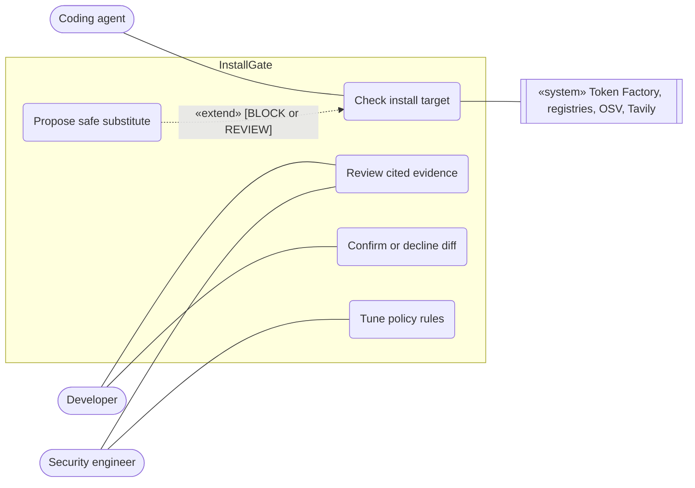
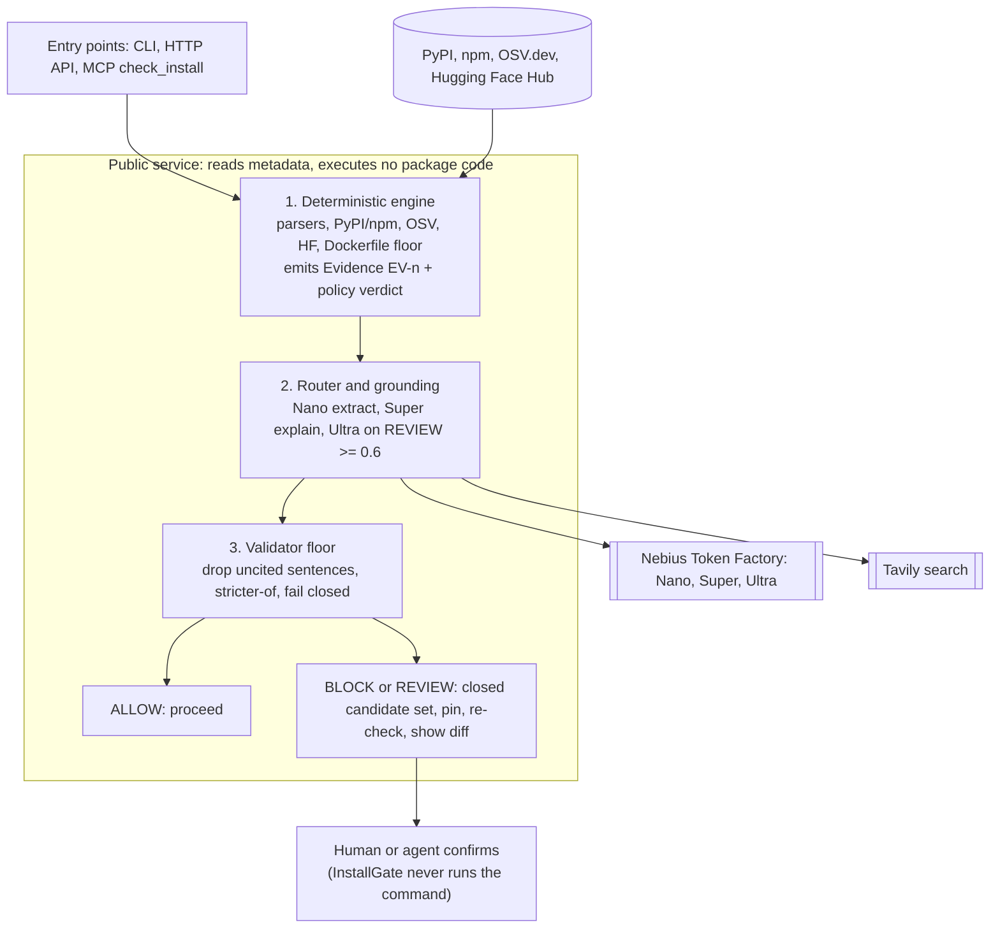
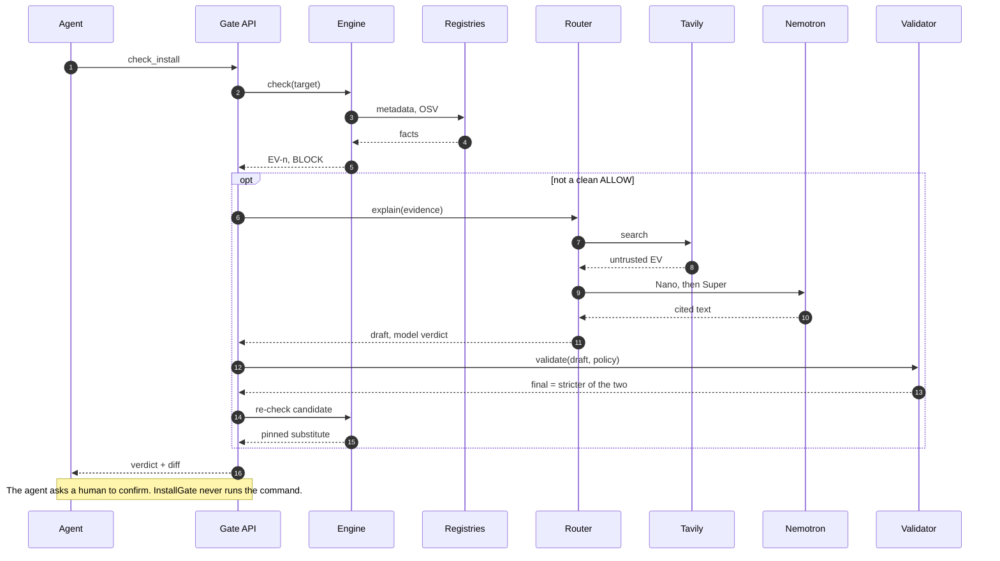
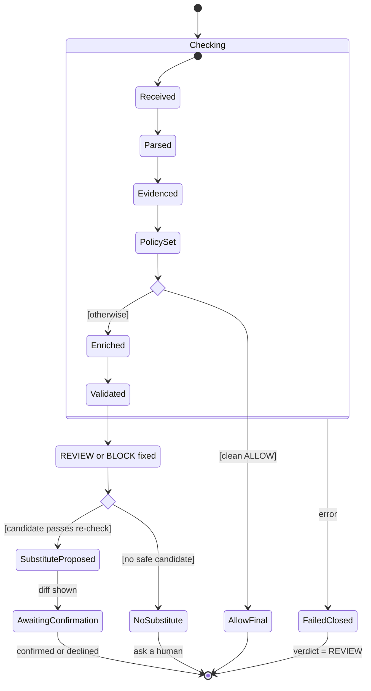
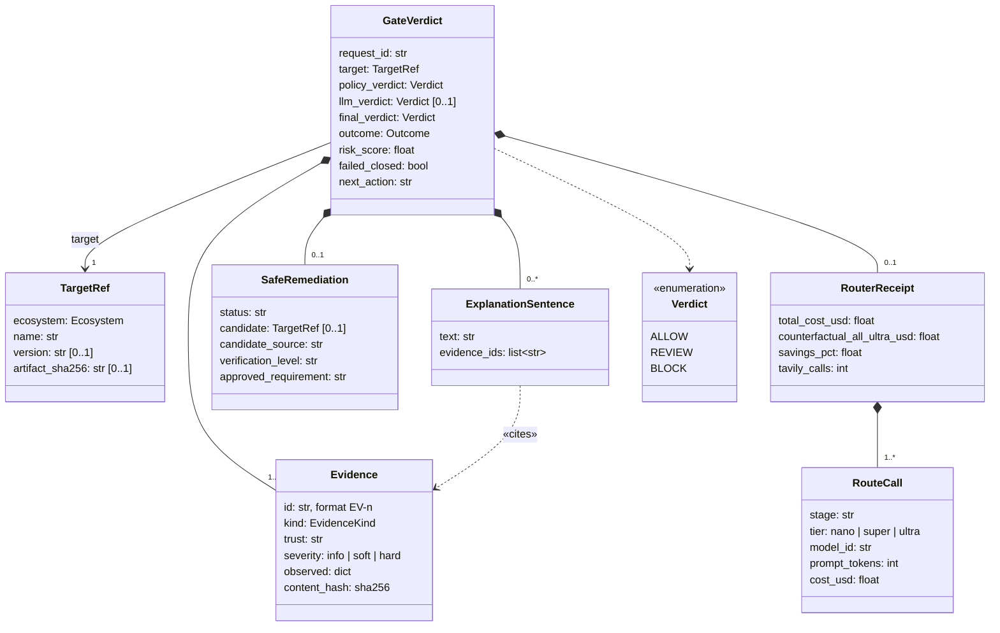

# InstallGate architecture (UML, Mermaid)

These diagrams are the text versions of the ones in the product spec. GitHub, Cursor's Markdown preview and most editors render Mermaid directly. Edit them here; they are the source of truth for the repo.

## 1. Use case diagram

Mermaid has no native use case diagram, so this uses a flowchart with UML conventions: actors on the outside, use cases (rounded) inside the system boundary.

## 2. Component view

## 3. Sequence diagram: a blocked install

## 4. State machine

## 5. Class diagram: data contracts

Key attributes only. The full definitions, with validators, are in `contracts/contracts.py`.

